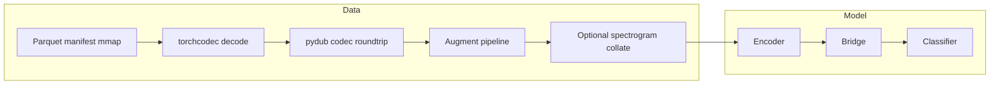

# ASV — TODOs & planning context

This file carries open work items and architectural context from the Cursor plan **ASV training backbone** (source: `~/.cursor/plans/asv_training_backbone_ebab09fb.plan.md`). Update checkboxes and notes as the repo evolves.

**Tooling:** `pyproject.toml` is the declarative project manifest (metadata, dependency specs, build config). `uv.lock` is the lockfile: the fully resolved dependency graph with pinned versions (and often hashes) so `uv sync` reproduces the same environment on every machine and in CI—similar to `package-lock.json` for npm or `poetry.lock` for Poetry.

## Overview (from plan)

Greenfield-style ASV training stack: Hydra-driven configs, Hugging Face Accelerate for multi-GPU, modular Encoder–Bridge–Classifier, configurable losses, Parquet memory-mapped indexing + decoding, codec simulation, augmentation pipeline (torch-audiomentations + custom pieces), and pluggable logging. Dataset/collate supports **both** raw-waveform and spectrogram paths.

> **Repo note:** the current entrypoint is `scripts/build_parquet_manifest.py` (`--dataset voxceleb2`), same Parquet schema idea.

## Architecture context (condensed)

| Area | Intent |
|------|--------|
| **Data** | PyArrow `ParquetFile` / mmap; row iteration; paths + labels (`audio_path`, `speaker_id`, etc.). |
| **Decode** | File paths → float waveform at target sample rate (torchcodec / fallbacks as configured). |
| **Codec** | Optional pydub/ffmpeg roundtrip presets; registry of format names; graceful failure when codec unavailable. |
| **Augment** | torch-audiomentations via Hydra-friendly `nn.Module` wrappers; custom modules (RawBoost, speed perturbation, TimeMask/CutMix in waveform and/or spectrogram domains). |
| **Model** | `Encoder` → `Bridge` → `Classifier`; `build_model(cfg.model)` with `hydra.utils.instantiate` on subtrees. |
| **Loss** | Config node `_target_` + kwargs; losses under `asv/losses/`. |
| **Multi-GPU** | Accelerate: `prepare`, `backward`, `wait_for_everyone`, unwrap for checkpoints. |
| **Logging** | Minimal protocol (params, metrics, artifacts, run id); swap MLflow-style backend via config. |

**Hydra groups (plan):** `model/`, encoder/bridge/classifier splits, `loss/`, `data/`, `augment/`, `codec/`, `optim/`, `logging/`, `train/`.

**Augmentation composition ideas:** staged lists (`pre_codec`, `codec`, `waveform_aug`, `feature_aug`); `Compose` with `per_example` for speaker ID; `OneOf` / Bernoulli gates; light/heavy YAML presets; MUSAN/RIRS paths in config.

**Dependencies (plan):** torch, torchaudio, torchcodec, pyarrow, pydub, torch-audiomentations, accelerate, hydra-core, omegaconf, tqdm; system ffmpeg; optional extras for RawBoost.

## Risks / decisions (from plan)

- Codec roundtrip is lossy and slow — keep optional (e.g. stochastic per step) and profile batch time.
- Validate torchcodec on target containers (e.g. OGG); optional `torchaudio.load` fallback behind a flag.
- For torch-audiomentations, pin version and verify class names against installed package.

---

## Open items (tracked todos)

- [x] Test augmentations end-to-end 
- [x] Test checkpoint saving (Accelerate/FSDP) 
- [x] Single-batch test
- [x] ~~Cursor ignore for `configs/logging/default.yaml` after testing~~
- [x] Add validation on VoxCeleb1 
- [x] Add / finalize loss function wiring
- [x] launch training
- [x] Robustness evaluation: baseline on full dataset; for each augmentation run a 1000-sample subset; report pooled EER on the augmented subsets
- [ ] Audit the code in the repo
- [ ] Add separate evaluation script
- [ ] Add ONNX/TRT conversion
- [ ] Add sliding-window evaluation
- [x] ~~Add TTA~~
- [x] Review `pin_memory`, `persistent_workers`
- [x] Review bf16 in dataloader configuration
- [x] Compute spectrograms on GPU
- [x] ~~Add hard sample dataset on validation~~
- [ ] Add new bitrates
- [ ] Add cosine similarity loss
- [ ] Add scheduling of margin
- [x] Add pooled result tracking
- [x] Check how augmented audio sounds in the training dataset (see `scripts/preview_training_dataset_augmentations.py`)
- [x] Research why the project needs both pyproject.toml and uv.lock
- [x] Log EER*100 instead of classical EER

## Backlog
- [ ] Add Wav2Vec2.0 Bert as encoder 

## Data pipeline bottlenecks (benchmark-backed)

- [x] Investigate and reduce codec roundtrip cost in the preprocessing path.
  - Proof: `python scripts/benchmark_data_pipeline.py --phase all --num-workers 0 --codec-preset mp3_16k --codec-only 1.0 --augment-only 0.0 --codec-then-augment 0.0 --iterations 16 --num-batches 16` reported `codec` mean around `21 ms/item`, throughput around `39 samples/s`, and around `819 ms/batch`.
  - Baseline without codec (`--codec-preset none`) was around `3.4 ms/item`, `323 samples/s`, and `99 ms/batch`, showing codec dominates input-time for the tested shape.
  - Latest repeatable comparison (patched in `scripts/benchmark_data_pipeline.py` with `--codec-baseline`) shows:
    - baseline (no codec, keep_all) `328.36 samples/s`, `48.73 ms/batch`
    - mp3_16k (codec-only) `39.78 samples/s`, `402.20 ms/batch`
    - net impact: `0.12x` throughput vs baseline.
  - Code evidence: `asv/data/parquet_dataset.py:145-153` (`_apply_codec`) + `asv/codec/pipeline.py:59-110` (`CodecPipeline.roundtrip`).

## Augs Bench for 4708 elements

BandPass - 0.41
Bandstop - 0.48
HighPass - 0.34
LowPass - 0.29
ColoredNoise - 0.29
BackgroundNoise - 2.06
RawBoost - 1.39
RiR - 0.48
SpeedPertuberation - 36.01
aac_16k - 4.39
aac_8k - 2.59
adpcm_ima_wav_16k - 1.33
amr_nb - 3.19
flac_16k - 2.10
g722_16k - 2.29
gsm_ms_8k - 2.55
mp3_16k - 2.55
mp3_8k - 2.19
opus_16k - 5.24
opus_8k - 2.49
pcm_alaw_8k - 1.47
pcm_mulaw_8k-1.47
speex16k - 3.09
speex8k - 2.47
vorbis16k - 3.08
vorbis8k -2.21

---

## Mermaid (from plan)

